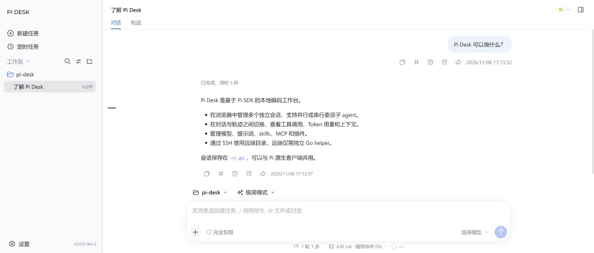
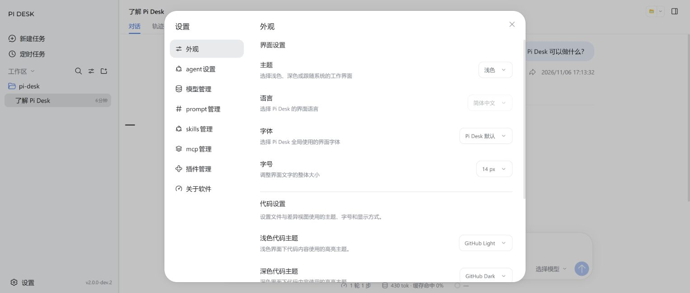

# Pi Desk

Pi Desk 是基于 **Node.js + Pi SDK + React** 的开源编码工作台，在浏览器中运行。

支持独立会话、子 agent、执行轨迹、Token / 上下文统计，以及模型、prompt、skills、MCP 和插件管理。SSH 工作区由本机 Pi SDK 调用远端 Go helper；会话保存在 `~/.pi`，与 Pi 原生客户端共用，同一会话避免同时写入。

## 开发者预览

项目仍在开发中，功能与配置可能调整。Agent 可读写工作区文件并执行命令。

## 运行

### 直接运行

需要 **Node.js 22.19+** 和 **Git**，直接运行 GitHub Releases 中的预构建包：

```sh
npx https://github.com/saucer-man/pi-desk/releases/download/v2.0.0-dev.3/pi-desk.tgz web
```

默认在 `http://127.0.0.1:30140` 启动并打开浏览器；在「设置 → 模型管理」配置模型后开始使用。传入 `--no-open` 可关闭自动打开，`--port 30141` 可指定端口。

无需 npm 账号，也无需手动下载或本机构建。SSH 需要本机 OpenSSH，远端无需 Node.js 或 Go。部分环境安装 PTY 依赖时需要 Python 3 和 C++ 编译工具。

### 从源码运行

另需 **Go 1.25+**，用于构建远端 helper。

```sh
git clone https://github.com/saucer-man/pi-desk.git
cd pi-desk
npm ci
npm run build
npm start
```

开发：`npm run dev`；构建与测试：`npm run check`。程序升级保留 `~/.pi` 中的数据。

## 运行截图

真实运行界面，使用演示会话。





## 反馈与许可

问题反馈：[GitHub Issues](https://github.com/saucer-man/pi-desk/issues)。

[Apache-2.0](LICENSE)。部分界面组件与样式来自 [DeepSeek Harness](https://github.com/deepseek-ai/deepseek-harness)，相关许可见 [DSH LICENSE](frontend/src/web/dsh/LICENSE.txt)。
